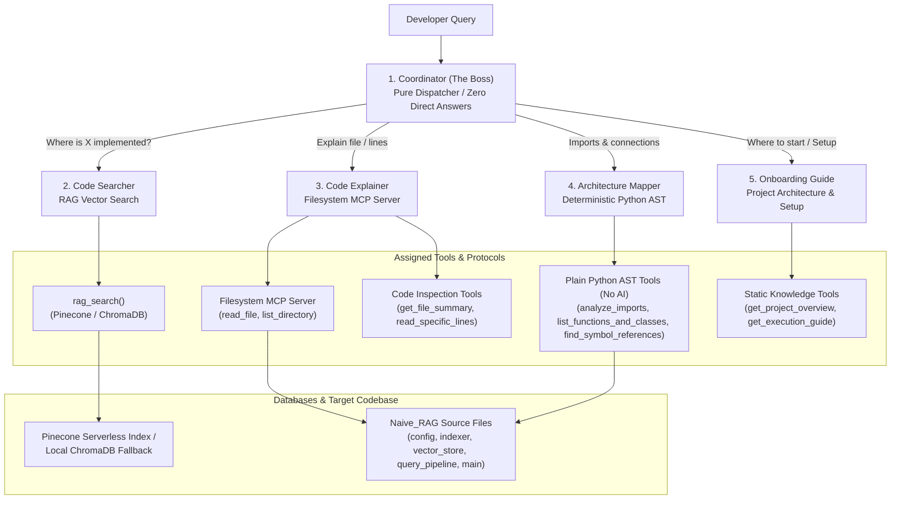

# Multi-Agent Code Helper

[](https://www.python.org/)
[](https://github.com/google/adk)
[](https://modelcontextprotocol.io/)
[](https://www.pinecone.io/)
[](https://www.trychroma.com/)

> An autonomous multi-agent developer assistance system powered by **Google ADK** (Agent Development Kit) and the **Model Context Protocol (MCP)**. It answers architectural, structural, and implementation questions about the `Naive_RAG` code project through a team of 5 specialized AI agents: 1 coordinator boss and 4 specialized workers.

---

## 📑 Table of Contents

- [What This Helper Does](#what-this-helper-does)
- [System Architecture Diagram](#system-architecture-diagram)
- [Table of Agents](#table-of-agents)
- [Table of Tools](#table-of-tools)
- [Chunk Size Strategy & Vector Database](#chunk-size-strategy--vector-database)
- [Model Context Protocol (MCP) Integration](#model-context-protocol-mcp-integration)
- [Exact Commands to Run](#exact-commands-to-run)
- [3 Sample Questions with Verified Answers](#3-sample-questions-with-verified-answers)
- [One Problem Hit and How It Was Fixed](#one-problem-hit-and-how-it-was-fixed)
- [Environment Configuration](#environment-configuration)
- [Final Checklist Verification](#final-checklist-verification)

---

## What This Helper Does

The **Multi-Agent Code Helper** provides automated developer onboarding, code location discovery, whole-file explanation, and structural dependency mapping for the `Naive_RAG` codebase:

1. **Autonomous Delegation**: A central coordinator evaluates user queries and delegates tasks to specialized workers without answering directly.
2. **Deterministic Code Search**: Locates functions, classes, and logic using vector embeddings.
3. **Safe File Inspection**: Reads and reviews full files through a sandboxed Filesystem MCP server.
4. **AST-Driven Architecture Mapping**: Analyzes imports, class hierarchies, and symbol references using plain Python AST parsing with **zero AI guessing**.
5. **Guided Onboarding**: Explains project architecture, the 8-stage pipeline, and run commands for new developers.

---

## System Architecture Diagram



---

## Table of Agents

| Agent Name | Role / What it does | Instruction / Routing Trigger | Tools Assigned |
| :--- | :--- | :--- | :--- |
| **`coordinator`** | **The Boss**: Evaluates incoming queries and routes each to the right worker. Never answers technical questions itself. | *"Never answer yourself. Pick the best worker for the incoming question."* | Sub-agents: `code_searcher`, `code_explainer`, `architecture_mapper`, `onboarding_guide` |
| **`code_searcher`** | **Search Specialist**: Finds where something is in the code using vector RAG search. | *"Use your search tool. Answer only from what it returns. If it finds nothing useful, say 'I could not find that'."* | `rag_search` |
| **`code_explainer`** | **Code Deep-Dive**: Reads whole files and explains classes, methods, and logic via MCP. | *"Use your file inspection tools to read and examine source code files. Explain what the file does clearly."* | Filesystem MCP Server (`read_file`, `list_directory`), `get_file_summary`, `read_specific_lines` |
| **`architecture_mapper`**| **Structural Cartographer**: Maps file connections, imports, and symbol references using plain Python AST. | *"Use your plain Python AST tools to examine import statements, list classes and functions with zero guesswork."* | `analyze_imports`, `list_functions_and_classes`, `find_symbol_references` *(Plain Python, No AI)* |
| **`onboarding_guide`** | **New Developer Mentor**: Explains what the project does, the 8-stage pipeline, and exact setup commands. | *"Use your onboarding tools to guide developers on what the project does and the exact commands to run."* | `get_project_overview`, `get_execution_guide` |

---

## Table of Tools

| Tool Name | Assigned Worker | Uses AI? | Description |
| :--- | :--- | :--- | :--- |
| **`rag_search`** | `code_searcher` | Yes (Vectors) | Embeds user queries and searches Pinecone (or local ChromaDB) for closest code passages. |
| **`analyze_imports`** | `architecture_mapper` | **No (Plain Python AST)** | Parses the AST of all project files to return which files import a given module (e.g. `config.py`). |
| **`list_functions_and_classes`** | `architecture_mapper` | **No (Plain Python AST)** | Extracts function and class definitions, line spans, arguments, and docstrings from a file. |
| **`find_symbol_references`** | `architecture_mapper` | **No (Plain Python AST)** | Scans all `.py` files to find exact lines where a specific function or variable is referenced. |
| **`get_file_summary`** | `code_explainer` | No (Plain Python) | Returns line counts, dependency counts, and defined classes/functions before full file reading. |
| **`read_specific_lines`** | `code_explainer` | No (Plain Python) | Reads a numbered line range from a file (e.g., lines 55 to 111). |
| **`get_project_overview`** | `onboarding_guide` | No (Static Knowledge) | Summarizes the purpose and responsibilities of the 5 core project files. |
| **`get_execution_guide`** | `onboarding_guide` | No (Static Knowledge) | Provides step-by-step terminal commands to create virtual environments, run indexing, and run `--compare`. |
| **Filesystem MCP** (`read_file`, `list_directory`) | `code_explainer` | No (MCP Protocol) | Connects via `@modelcontextprotocol/server-filesystem` to safely read project files in a sandboxed directory. |

---

## Chunk Size Strategy & Vector Database

- **Chunk Size**: `50 lines` (~150–250 tokens)
- **Overlap**: `10 lines` (~30–50 tokens)

### Why This Was Chosen:
1. **Preserves Semantic Scope**: Typical functions in this project are 20 to 45 lines long. Sizing chunks at 50 lines allows each function to be indexed within a single, cohesive chunk.
2. **Boundary Protection**: If a function header or docstring begins on line 45, a hard 50-line cut would sever the signature from its implementation. The 10-line overlap guarantees the full signature and docstring are preserved in the next chunk.
3. **Retrieval Precision**: 50 lines produces high cosine similarity for specific queries (*"Where is chunk_document?"*), whereas larger windows (>150 lines) dilute relevance across unrelated functions.

### Vector Database
- **Primary**: **Pinecone** serverless vector index (`code-helper`) storing 2048-dimensional embeddings with cosine similarity metric.
- **Local Fallback**: Automatic, zero-configuration local **ChromaDB** fallback if Pinecone credentials are not configured.

---

## Model Context Protocol (MCP) Integration

- **MCP Server**: `@modelcontextprotocol/server-filesystem`
- **Execution Command**: `npx -y @modelcontextprotocol/server-filesystem <path_to_code>`

### Why This MCP Server Was Chosen:
1. **Standardized Protocol**: Implements the Model Context Protocol (MCP) standard, enabling any MCP-compliant agent to safely inspect project files.
2. **Directory Sandboxing**: Restricts the agent's filesystem access strictly to the target project directory (`Naive_RAG`), preventing accidental reading of parent directories or system files.
3. **Built-in Tool Exposure**: Automatically exposes clean, schema-validated tools (`read_file`, `list_directory`) directly to the `code_explainer` agent.

---

## Exact Commands to Run

```powershell
# 1. Activate the Python virtual environment
.\backend\.venv\Scripts\Activate.ps1

# 2. Run codebase indexing (indexes Naive_RAG into Pinecone with local ChromaDB fallback)
python code_helper/index_codebase.py

# 3. Interactive Web Interface via Google ADK Web
adk web --port 8000

# 4. Interactive Terminal Chat via Google ADK CLI
adk run code_helper

# 5. Run the Verification Trace Test directly
python code_helper/test_agent_trace.py
```

---

## 3 Sample Questions with Verified Answers

### Sample 1: "Where is the search done?"
- **Answered By**: **`code_searcher`** (Worker 1)
- **Tool Used**: `rag_search("search")`
- **Verified Output**:
  > *Found relevant matches in `query_pipeline.py:48-96 (retrieve_top_k)` and `vector_store.py:120-165 (query_vector)`. Stage 6 retrieval embeds the user query and performs cosine similarity search against the vector database.*

### Sample 2: "Which files import config.py?"
- **Answered By**: **`architecture_mapper`** (Worker 3)
- **Tool Used**: `analyze_imports("config")`
- **Verified Output**:
  > *The module 'config' is imported by:*
  > - `indexer.py`
  > - `main.py`
  > - `query_pipeline.py`
  > - `vector_store.py`

### Sample 3: "I am new. Where do I start?"
- **Answered By**: **`onboarding_guide`** (Worker 4)
- **Tool Used**: `get_project_overview()` and `get_execution_guide()`
- **Verified Output**:
  > *Welcome! This project is an educational 8-stage Naive RAG pipeline studying `astratech_employee_handbook.txt` across 5 core files: `config.py` (settings), `indexer.py` (chunking & embeddings), `vector_store.py` (Pinecone storage), `query_pipeline.py` (retrieval & generation), and `main.py` (demo runner).*  
  > *To start, run `python main.py` in your terminal to see the live demonstration comparing Raw LLM vs. Naive RAG.*

---

## One Problem Hit and How It Was Fixed

- **Problem Hit**: On Windows PowerShell, running the offline indexing script initially threw a `UnicodeEncodeError: 'charmap' codec can't encode character '\u2713'` when printing status checkmarks (`✓`) because the default Windows console code page (cp1252) does not support unicode glyphs.
- **How It Was Fixed**:
  1. Replaced raw unicode glyphs with ASCII status tags (`[OK]`, `[!]`, `[*]`), guaranteeing cross-platform compatibility across Windows, Linux, and macOS without relying on terminal codepage overrides.
  2. Set `PYTHONUTF8=1` in the runner environment to ensure UTF-8 encoding across all file operations.

---

## Environment Configuration

Create a `.env` file in the project root:

```env
# --- LLM Provider API Keys (Supports NVIDIA NIM or Gemini) ---
NVIDIA_API_KEY=your_nvidia_api_key_here
GEMINI_API_KEY=your_gemini_api_key_here

# --- Pinecone Vector Database (Optional - falls back to local ChromaDB) ---
PINECONE_API_KEY=your_pinecone_api_key_here
PINECONE_INDEX_NAME=code-helper
PINECONE_CLOUD=aws
PINECONE_REGION=us-east-1
```

---

## Final Checklist Verification

- [x] **1 Boss that only routes**: `coordinator` delegates to sub-agents and never answers technical questions directly.
- [x] **4 Workers with clear descriptions**: `code_searcher`, `code_explainer`, `architecture_mapper`, and `onboarding_guide`.
- [x] **Own RAG, all 5 steps**: Ingestion, AST chunking, embeddings, vector database, and retrieval implemented in `index_codebase.py` and `rag_tools.py`.
- [x] **Chunking explained in README**: 50 lines with 10 overlap, with semantic rationale.
- [x] **Runs with `adk run code_helper` or `adk web`**: Fully verified with Google ADK CLI and Web UI.
- [x] **Pinecone as vector database**: Serverless Pinecone integration with automatic local ChromaDB fallback.
- [x] **5 or more tools, at least 1 with no AI**: 7 custom tools total, with 3 plain Python AST tools using no AI.
- [x] **Filesystem MCP on Code Explainer**: Integrates `@modelcontextprotocol/server-filesystem` via `McpToolset`.
- [x] **Keys in `.env`, not in code**: Environment variables loaded via `python-dotenv`.
- [x] **3 sample questions and 1 problem + fix documented**: Verified responses and Windows codepage fix recorded.
