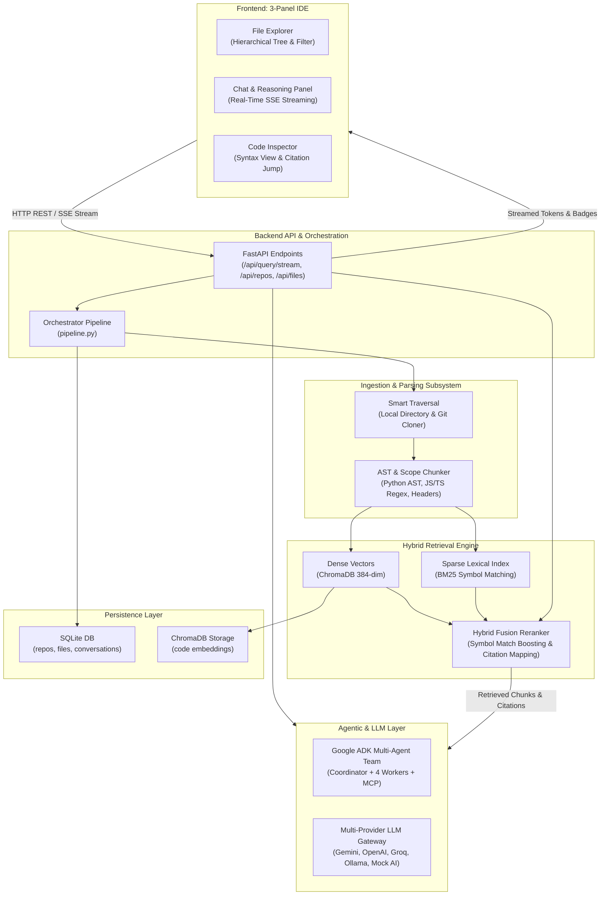

# 🧠 Repomind — AI Codebase Intelligence & Multi-Agent RAG

[](https://www.python.org/)
[](https://fastapi.tiangolo.com/)
[](https://react.dev/)
[](https://vitejs.dev/)
[](https://www.trychroma.com/)
[](https://github.com/google/adk)
[](https://modelcontextprotocol.io/)

> **Repomind** is an end-to-end AI-powered codebase intelligence system. It indexes, maps, and answers architectural, structural, and implementation questions across any local folder or GitHub repository with **syntax-aware AST chunking**, **hybrid retrieval (ChromaDB + BM25)**, **interactive line citation highlights**, and an autonomous **Google ADK multi-agent team**.

---

## 📑 Table of Contents

- [🌟 Core Features](#-core-features)
- [🏗️ System Architecture](#️-system-architecture)
- [🤖 Google ADK Multi-Agent Team](#-google-adk-multi-agent-team)
- [🚀 Quick Start Guide](#-quick-start-guide)
- [⚙️ Configuration & Environment](#️-configuration--environment)
- [🔌 REST & Streaming API Reference](#-rest--streaming-api-reference)
- [🖥️ 3-Panel IDE Web Dashboard](#️-3-panel-ide-web-dashboard)
- [🧪 Testing & Verification](#-testing--verification)
- [📂 Project Directory Structure](#-project-directory-structure)

---

## 🌟 Core Features

### 1. 3-Panel IDE Web Dashboard
- **Left Panel (File Explorer)**: Hierarchical tree view with language badges, line counts, byte sizes, and real-time substring filtering.
- **Center Panel (Conversational RAG Chat)**: Real-time token streaming via Server-Sent Events (SSE), architectural prompt suggestion chips, and interactive citation badges.
- **Right Panel (Code Inspector)**: In-depth code viewer with line numbers, copy actions, and **auto-scrolling citation highlights** when clicking reference badges in chat.

### 2. Syntax & Scope-Aware AST Chunking
- Parses Python source files using Python's native `ast` module to split code along function, class, and method boundaries.
- Uses regex heuristic parsers for JavaScript, TypeScript, JSON, and Markdown headers.
- Preserves function signatures, docstrings, exact start/end line numbers, and symbol identifiers (50-line target window with 10-line overlap).

### 3. Hybrid Retrieval Engine (ChromaDB + BM25)
- **Dense Vectors (ChromaDB)**: 384-dimensional dense semantic vectors persisted in local ChromaDB collections under `data_store/chroma/`.
- **Sparse Lexical Search (BM25)**: Rank-BM25 index with camelCase and snake_case tokenization for exact variable, function, and identifier matching.
- **Reciprocal Rank Fusion (RRF)**: Combines dense vector similarity and sparse keyword scores, boosting chunks whose symbol names match query keywords by 1.3×.

### 4. Multi-Provider LLM Gateway
- **Google Gemini**: High-speed reasoning with `gemini-2.5-flash` or `gemini-1.5-pro`.
- **OpenAI**: `gpt-4o-mini` and `gpt-4o`.
- **Groq**: Ultra-low latency inference with `llama-3.3-70b-versatile`.
- **Local Ollama**: 100% private local execution via `llama3.2` or `deepseek-coder`.
- **Grounded Offline Mock AI**: Instant offline development mode that answers directly from retrieved code chunks without requiring any API keys.

### 5. Multi-Source Ingestion
- **Local Directories**: Point Repomind to any local folder on your computer for instant indexing.
- **GitHub Repositories**: Shallow clones public or private GitHub repositories via URL.
- **Smart Noise Filtering**: Automatically ignores `.git`, `node_modules`, `venv`, `dist`, build artifacts, and respects `.gitignore`.

---

## 🏗️ System Architecture

### System Flow Diagram



---

## 🤖 Google ADK Multi-Agent Team

Repomind includes an autonomous multi-agent developer team located in [`code_helper/`](file:///c:/Users/patil/OneDrive/Desktop/Repomind/code_helper), built using the **Google Agent Development Kit (ADK)** and the **Model Context Protocol (MCP)**:

| Agent Name | Role / Function | Operational Rule | Tools Assigned |
| :--- | :--- | :--- | :--- |
| **`coordinator`** | **The Boss / Dispatcher** | Pure router. Evaluates queries and delegates to the right worker. Never answers technical questions directly. | Sub-agents: `code_searcher`, `code_explainer`, `architecture_mapper`, `onboarding_guide` |
| **`code_searcher`** | **Code Search Specialist** | Answers *"Where is X implemented?"* using vector search. Answers strictly from retrieved snippets. | `rag_search` (Pinecone / local ChromaDB) |
| **`code_explainer`** | **Code Deep-Dive & Review** | Reads whole source files and explains classes, algorithms, and logic. | **Filesystem MCP Server** (`read_file`, `list_directory`), `get_file_summary`, `read_specific_lines` |
| **`architecture_mapper`**| **Structural Cartographer** | Answers *"Who imports config.py?"* or lists class hierarchies using plain Python AST with zero AI guesswork. | `analyze_imports`, `list_functions_and_classes`, `find_symbol_references` *(AST, No AI)* |
| **`onboarding_guide`** | **New Developer Mentor** | Explains project purpose, 8-stage pipeline overview, and exact setup commands. | `get_project_overview`, `get_execution_guide` |

### Running the Multi-Agent Assistant

```powershell
# 1. Activate the backend virtual environment
.\backend\.venv\Scripts\Activate.ps1

# 2. Launch Google ADK Web UI (Browser Interface)
adk web --port 8000

# 3. Or launch Google ADK Interactive Terminal Chat (CLI)
adk run code_helper
```

---

## 🚀 Quick Start Guide

### Prerequisites
- **Python 3.10+** (Python 3.11 recommended)
- **Node.js 18+** & **npm**

---

### Method A: Single-Click Launch (Windows)

- Double-click **[`run_repomind.bat`](file:///c:/Users/patil/OneDrive/Desktop/Repomind/run_repomind.bat)**  
  *or*
- In PowerShell, run:
  ```powershell
  .\run_repomind.ps1
  ```

This automatically launches the FastAPI backend on port 8000, starts the Vite React frontend on port 5173, and opens your browser.

---

### Method B: Manual Step-by-Step Launch

#### 1. Start the Backend Server (FastAPI)
```powershell
cd backend
.\.venv\Scripts\Activate.ps1
python -m uvicorn main:app --host 127.0.0.1 --port 8000 --reload
```
The backend API is now running at: `http://127.0.0.1:8000`  
Swagger API Docs available at: `http://127.0.0.1:8000/docs`

#### 2. Start the Frontend Server (Vite + React)
Open a new terminal:
```powershell
cd frontend
npm install
npm run dev
```
Open your browser and navigate to: **`http://localhost:5173/`**

---

## ⚙️ Configuration & Environment

Repomind works out of the box using **Offline Grounded Mock AI Mode** without requiring any API keys. To connect external cloud LLMs, create or edit `.env` in the project root:

```env
# --- LLM Provider API Keys (Optional) ---
GEMINI_API_KEY=your_gemini_api_key_here
OPENAI_API_KEY=your_openai_api_key_here
GROQ_API_KEY=your_groq_api_key_here

# --- Default Provider & Model ---
DEFAULT_PROVIDER=gemini          # gemini | openai | groq | ollama | mock
DEFAULT_MODEL=gemini-2.5-flash

# --- Local Ollama (Optional) ---
OLLAMA_BASE_URL=http://localhost:11434

# --- Pinecone Vector Database (Optional - defaults to local ChromaDB) ---
PINECONE_API_KEY=your_pinecone_api_key_here
PINECONE_INDEX_NAME=code-helper

# --- GitHub Ingestion (Optional - higher rate limits for private repos) ---
GITHUB_TOKEN=your_github_personal_access_token
```

---

## 🔌 REST & Streaming API Reference

The FastAPI backend exposes clean REST endpoints and SSE streaming channels:

| Method | Endpoint | Description |
| :--- | :--- | :--- |
| `GET` | `/api/health` | Health check, active model, and provider status. |
| `GET` | `/api/repos` | Lists all indexed repositories. |
| `POST` | `/api/repos/index` | Ingests and indexes a repository (local path or GitHub URL). |
| `GET` | `/api/repos/{id}` | Retrieves metadata and chunk statistics for a repository. |
| `DELETE`| `/api/repos/{id}` | Deletes a repository, its file catalog, and its ChromaDB collection. |
| `GET` | `/api/repos/{id}/tree` | Returns the hierarchical directory tree with file metadata. |
| `GET` | `/api/repos/{id}/file?path=...` | Reads file content with path traversal security protection. |
| `GET` | `/api/repos/{id}/messages` | Fetches persistent chat history for the repository. |
| `POST` | `/api/repos/{id}/chat/stream` | Server-Sent Events (SSE) streaming endpoint returning real-time response tokens and citation badges. |
| `POST` | `/api/settings` | Updates active provider, model, and runtime credentials. |

---

## 🖥️ 3-Panel IDE Web Dashboard

```
┌──────────────────────────┬──────────────────────────────────────┬──────────────────────────┐
│  📁 File Explorer        │  💬 Conversational RAG Chat          │  🔍 Code Inspector       │
├──────────────────────────┼──────────────────────────────────────┼──────────────────────────┤
│ 🔍 [Filter files...]     │  User: Where is search implemented?  │ 📄 query_pipeline.py:48  │
│                          │                                      │                          │
│ 📁 backend/              │  Repomind:                           │ 48: def retrieve_top_k(  │
│   ├── 🐍 config.py       │  Search is handled in Stage 6 of the │ 49:     query: str,      │
│   ├── 🐍 pipeline.py     │  retrieval pipeline via cosine       │ 50:     top_k: int = 5   │
│   └── 🐍 main.py         │  similarity matching.                │ 51: ):                   │
│ 📁 frontend/src/         │                                      │ 52:     # Embed query    │
│   ├── ⚛️ App.jsx         │  Sources:                            │ 53:     vec = embed(...) │
│   └── 🎨 index.css       │  [query_pipeline.py:48-96] ↗         │ 54:     return db.search │
│                          │  [vector_store.py:120-165] ↗         │                          │
│                          │                                      │ 💡 Auto-scrolls to cited │
│                          │  [Ask anything about codebase...]    │    lines on badge click! │
└──────────────────────────┴──────────────────────────────────────┴──────────────────────────┘
```

- **Live SSE Streaming**: Watch tokens appear in real time as the model reasons over code.
- **Interactive Citations**: Click any source citation badge (e.g. `[main.py:15-45]`) to instantly load the file in the Code Inspector and auto-scroll to the exact line range with a highlighted pulse animation.
- **Prompt Chips**: One-click prompt chips on empty chat states allow instant exploration (*"Explain architecture"*, *"Where is data ingested?"*, *"Show main entrypoint"*).

---

## 🧪 Testing & Verification

Repomind includes built-in verification scripts to test multi-agent execution, tool dispatching, and codebase indexing:

```powershell
# 1. Test offline indexing pipeline (chunks Naive_RAG into ChromaDB / Pinecone)
python code_helper/index_codebase.py

# 2. Run the end-to-end multi-agent verification trace
python code_helper/test_agent_trace.py
```

---

## 📂 Project Directory Structure

```
Repomind/
├── .agents/
│   └── mcp_config.json           # Model Context Protocol server configuration
├── backend/
│   ├── config.py                 # Central settings, storage paths & LLM parameters
│   ├── pipeline.py               # Ingestion orchestrator & workspace auto-indexer
│   ├── main.py                   # FastAPI REST API & SSE streaming server
│   ├── db/
│   │   └── database.py           # SQLite database for repositories, files & conversations
│   ├── ingestion/
│   │   ├── file_crawler.py       # Smart traversal with .gitignore & noise filtering
│   │   └── git_cloner.py         # Shallow Git cloner for remote repositories
│   ├── parser/
│   │   └── code_chunker.py       # AST & scope-aware multi-language chunker
│   ├── retrieval/
│   │   ├── vector_store.py       # ChromaDB persistent dense vector store
│   │   ├── bm25_index.py         # BM25 sparse keyword & symbol search index
│   │   └── hybrid_retriever.py   # Hybrid fusion with symbol match boosting
│   └── llm/
│       └── providers.py          # Unified Gemini/OpenAI/Groq/Ollama/Mock adapter
├── code_helper/                  # Google ADK Autonomous Multi-Agent Team
│   ├── agent.py                  # 1 Boss + 4 Workers agent orchestration
│   ├── cli.py                    # Interactive terminal CLI chat interface
│   ├── prompts.py                # Behavioral guidelines and system prompts
│   ├── index_codebase.py         # Offline code indexing pipeline
│   ├── test_agent_trace.py       # Verification and trace test suite
│   └── tools/                    # Tool definitions (AST, RAG, Onboarding, Code)
├── frontend/                     # React + Vite 3-Panel IDE Web Dashboard
│   ├── src/
│   │   ├── App.jsx               # Main state orchestrator
│   │   ├── index.css             # Vanilla CSS design system (IDE dark theme)
│   │   └── components/
│   │       ├── Header.jsx        # Navigation, repo switcher & settings dialogs
│   │       ├── FileExplorer.jsx  # Hierarchical tree explorer with search
│   │       ├── ChatPanel.jsx     # Streaming chat with citation badges
│   │       ├── CodeInspector.jsx # Syntax viewer with auto-scroll highlighting
│   │       ├── IngestModal.jsx   # Ingestion dialog (Local / GitHub)
│   │       └── SettingsModal.jsx # LLM provider & API credentials modal
├── data_store/                   # Persistent storage (SQLite DB & ChromaDB collections)
├── run_repomind.bat              # 1-Click Windows batch launcher
└── run_repomind.ps1              # 1-Click PowerShell launcher
```

---

## 📄 License

This project is licensed under the **MIT License**. Feel free to use, modify, and distribute it for personal and commercial projects.
