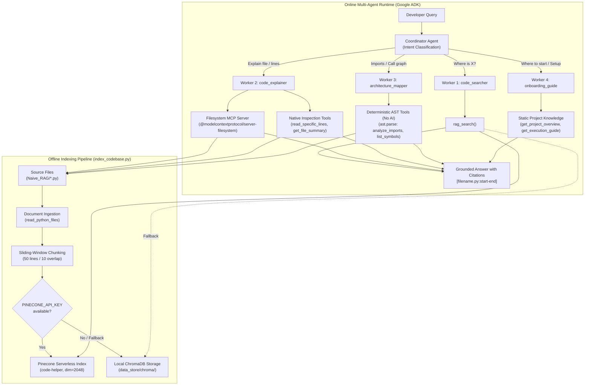

# Repomind — Multi-Agent Code Helper

[](https://www.python.org/)
[](https://github.com/google/adk)
[](https://modelcontextprotocol.io/)
[](https://www.pinecone.io/)
[](https://www.trychroma.com/)

> **Repomind** is an autonomous multi-agent code intelligence and developer onboarding system built with **Google Agent Development Kit (ADK)** and the **Model Context Protocol (MCP)**. It indexes, navigates, and explains software repositories without hallucinations through a team of five specialized agents: a central supervisor (`coordinator`) and four targeted worker agents (`code_searcher`, `code_explainer`, `architecture_mapper`, and `onboarding_guide`).

---

## 📑 Table of Contents

- [1. Problem Statement & Motivation](#1-problem-statement--motivation)
- [2. Key Features](#2-key-features)
- [3. Multi-Agent Architecture](#3-multi-agent-architecture)
- [4. System Architecture Diagram](#4-system-architecture-diagram)
- [5. Detailed RAG Pipeline](#5-detailed-rag-pipeline)
- [6. Technologies Used](#6-technologies-used)
- [7. Project Folder Structure](#7-project-folder-structure)
- [8. Prerequisites](#8-prerequisites)
- [9. Installation & Setup (Windows PowerShell)](#9-installation--setup-windows-powershell)
- [10. Environment Variable Configuration](#10-environment-variable-configuration)
- [11. Exact Commands to Run](#11-exact-commands-to-run)
- [12. Example Questions for Each Agent](#12-example-questions-for-each-agent)
- [13. End-to-End Query Lifecycle](#13-end-to-end-query-lifecycle)
- [14. Testing & Troubleshooting](#14-testing--troubleshooting)
- [15. Limitations & Future Improvements](#15-limitations--future-improvements)

---

## 1. Problem Statement & Motivation

When onboarding onto an unfamiliar codebase, software engineers spend hours tracing function definitions, deciphering cross-module import chains, and determining which terminal commands initialize dependencies. 

Standard generative AI assistants struggle in this environment because:
1. **Hallucinations**: Generative LLMs guess file names, non-existent arguments, and phantom imports when answering from memory.
2. **Context Window Saturation**: Passing an entire repository into a prompt wastes tokens, exceeds context limits, and degrades reasoning precision.
3. **Lack of Specialization**: A single prompt cannot effectively act as an import parser, a semantic search engine, and an architectural tutor at the same time.

**Repomind solves this** by decomposing codebase intelligence into a strict multi-agent hierarchy:
- Semantic questions (*"Where is similarity calculated?"*) are routed to vector-based code retrieval.
- File deep-dives (*"Explain indexer.py"*) read verified disk contents via a sandboxed Model Context Protocol server.
- Dependency questions (*"Which files import config.py?"*) are answered with **zero AI guesswork** using Python's deterministic Abstract Syntax Tree (`ast`).
- New engineers receive structured setup guidance and pipeline diagrams directly from grounded project facts.

---

## 2. Key Features

- **Strict Multi-Agent Routing**: A central coordinator acts as a pure dispatcher, classifying user intent and delegating to specialized workers while strictly forbidden from answering directly.
- **Deterministic AST Cartography**: Uses Python's native `ast` library to trace import dependencies and extract classes and functions without generative model guessing.
- **Dual Vector Storage (Pinecone + ChromaDB)**: Indexes source code into a Pinecone serverless vector index, with an automatic, zero-configuration local ChromaDB fallback.
- **Sandboxed File Access via MCP**: The Code Explainer inspects source files using the standardized `@modelcontextprotocol/server-filesystem` server, ensuring safe directory-restricted read access.
- **Flexible LLM Provider Support**: Runs via `LiteLLM` across **NVIDIA NIM** (`meta/llama-3.2-11b-vision-instruct`), **Google Gemini** (`gemini-2.5-flash`), or **OpenAI** (`gpt-4o-mini`).
- **Dual Execution Interfaces**: Fully compatible with both the Google ADK Web UI (`adk web`) and the interactive command-line interface (`adk run code_helper` or `python code_helper/cli.py`).

---

## 3. Multi-Agent Architecture

The multi-agent system is implemented in [`code_helper/agent.py`](code_helper/agent.py) with role prompts defined in [`code_helper/prompts.py`](code_helper/prompts.py). It consists of one coordinator boss and four specialized worker agents:

```
                          ┌───────────────────────────┐
                          │    coordinator (Boss)     │
                          │   "Never answers itself"  │
                          └─────────────┬─────────────┘
                                        │
         ┌──────────────────┬───────────┴───────────┬──────────────────┐
         ▼                  ▼                       ▼                  ▼
┌─────────────────┐ ┌─────────────────┐   ┌─────────────────┐ ┌─────────────────┐
│  code_searcher  │ │  code_explainer │   │  architecture_  │ │   onboarding_   │
│                 │ │                 │   │     mapper      │ │      guide      │
│ "Where is it?"  │ │ "What does this │   │ "How are files  │ │"Where do I start│
│                 │ │    file do?"    │   │   connected?"   │ │  & how to run?" │
└────────┬────────┘ └────────┬────────┘   └────────┬────────┘ └────────┬────────┘
         │                   │                     │                   │
         ▼                   ▼                     ▼                   ▼
    [rag_search]      [Filesystem MCP]      [analyze_imports]    [get_project_
                      [file_summary]        [list_symbols]        overview]
                      [read_lines]          [find_references]    [get_execution_
                                                                  guide]
```

### Table of Agents

| Agent Identifier | Human Role | Operational Directive & Instruction Trigger | Assigned Toolset |
| :--- | :--- | :--- | :--- |
| **`coordinator`** | **The Boss / Dispatcher** | Pure dispatcher. Evaluates user input, classifies intent, and delegates to the single best worker. *Never answers technical questions directly.* | Sub-agents: `code_searcher`, `code_explainer`, `architecture_mapper`, `onboarding_guide` |
| **`code_searcher`** | **Code Search Specialist** | Answers *"Where is X implemented?"*. Queries vector storage and answers strictly from retrieved code passages. If nothing matches, states *"I could not find that in the indexed code"*. | `rag_search` |
| **`code_explainer`** | **Code Reviewer & Deep-Dive** | Answers *"Explain what this file does"*. Inspects disk files to explain architecture, class roles, and line spans with technical clarity. | Filesystem MCP (`read_file`, `list_directory`), `get_file_summary`, `read_specific_lines` |
| **`architecture_mapper`**| **Structural Cartographer** | Answers *"Which files import config.py?"* or *"List all functions in indexer.py"*. Uses plain Python AST with **zero AI guessing**. | `analyze_imports`, `list_functions_and_classes`, `find_symbol_references` |
| **`onboarding_guide`** | **New Developer Mentor** | Answers *"Where do I start?"* and *"How do I run the project?"*. Explains the pipeline architecture and provides verified execution commands. | `get_project_overview`, `get_execution_guide` |

---

## 4. System Architecture Diagram

The flowchart below illustrates the actual execution paths in the codebase:



---

## 5. Detailed RAG Pipeline

The RAG pipeline is implemented in [`code_helper/index_codebase.py`](code_helper/index_codebase.py) (indexing) and [`code_helper/tools/rag_tools.py`](code_helper/tools/rag_tools.py) (retrieval):

### Step 1: Source File Discovery
- Scans the target project folder ([`Naive_RAG`](Naive_RAG)) for all `.py` files.
- Reads file content with UTF-8 encoding (falling back to replacement characters for cross-platform compatibility).

### Step 2: Syntax- & Scope-Aware Chunking Strategy
- **Window Size**: `50 lines` (~150–250 tokens per chunk).
- **Window Overlap**: `10 lines` (~30–50 tokens).
- **Step Size**: `40 lines` (`CHUNK_SIZE_LINES - CHUNK_OVERLAP_LINES`).

**Why This Strategy Was Chosen:**
1. **Semantic Function Preservation**: Python functions across the target codebase average between 20 and 45 lines. A 50-line window allows most functions to reside entirely within a single chunk.
2. **Boundary Protection**: If a function signature begins on line 45, a hard 50-line cut would sever the definition from its body. The 10-line overlap guarantees the complete header and docstring are preserved in the subsequent chunk.
3. **Retrieval Precision**: 50 lines provides high cosine similarity matching for targeted questions (*"Where is cosine similarity calculated?"*) without diluting relevance across unrelated classes.

### Step 3: Embedding Generation & Vector Storage
- **Primary Database (Pinecone)**:
  - If `PINECONE_API_KEY` is present, connects to Pinecone and initializes a serverless index named `code-helper` (`dimension=2048`, `metric=cosine`, `cloud=aws`, `region=us-east-1`).
  - Upserts chunk text, start line, end line, and file path as metadata.
- **Local Fallback (ChromaDB)**:
  - If no Pinecone key is configured or if the network is unavailable, the pipeline falls back to `backend.retrieval.vector_store` using local ChromaDB persistent storage (`data_store/chroma/`).

### Step 4: Retrieval and Ranking
- When `rag_search(query)` executes:
  1. Queries the Pinecone `code-helper` index for the top-4 closest vector matches.
  2. If Pinecone is unconfigured or encounters an error, falls back to ChromaDB dense vector search fused with BM25 keyword matching via [`backend/retrieval/hybrid_retriever.py`](backend/retrieval/hybrid_retriever.py).
  3. Applies a **1.3× score multiplier boost** to code chunks where query keywords match actual function or class symbol names.

### Step 5: Context Construction & Answer Generation
- The retrieved code snippet is formatted with its file path and line numbers: `[filename.py:start_line-end_line]`.
- The worker agent grounds its explanation exclusively on this context and outputs the mandatory citation format.

---

## 6. Technologies Used

| Technology | Purpose | Actual Usage in this Codebase |
| :--- | :--- | :--- |
| **Google ADK (`google-adk`)** | Agent Framework | Orchestrates the `LlmAgent` team, sub-agent delegation hierarchy, and session management via `adk web` and `adk run`. |
| **LiteLLM (`litellm`)** | Multi-Provider Gateway | Standardizes model calls in `code_helper/agent.py` to NVIDIA NIM, Google Gemini, or OpenAI. |
| **Model Context Protocol (MCP)** | File System Toolset | Connects `code_explainer` to `@modelcontextprotocol/server-filesystem` via stdio for directory-sandboxed file reading. |
| **Pinecone (`pinecone`)** | Primary Vector Database | Cloud serverless vector index (`code-helper`) storing code embeddings with cosine distance. |
| **ChromaDB (`chromadb`)** | Local Vector Database | Zero-configuration local vector storage fallback persisted under `data_store/chroma/`. |
| **Python `ast` Module** | Static Code Analysis | Deterministic, zero-AI parsing of import trees, class definitions, function signatures, and docstrings in `ast_tools.py`. |
| **Rank-BM25 (`rank-bm25`)** | Lexical Code Search | Keyword search with identifier tokenization used in the local hybrid retrieval fallback engine. |
| **FastAPI (`fastapi`)** | REST & SSE Backend | Serves the web endpoints, repo catalog, and token-streaming APIs in `backend/main.py`. |
| **python-dotenv (`python-dotenv`)** | Environment Loading | Loads API keys and configurations from `.env` without hardcoding credentials in code. |

---

## 7. Project Folder Structure

```
Repomind/
├── .agents/
│   └── mcp_config.json               # Filesystem MCP server definition
├── backend/
│   ├── config.py                     # Central configuration & storage directory paths
│   ├── main.py                       # FastAPI REST API & SSE streaming server
│   ├── pipeline.py                   # Repository ingestion & indexing orchestrator
│   ├── requirements.txt              # Core backend dependencies
│   ├── db/
│   │   └── database.py               # SQLite storage for repositories & conversations
│   ├── ingestion/
│   │   ├── file_crawler.py           # Directory crawler with .gitignore & noise filtering
│   │   └── git_cloner.py             # Git repository cloner
│   ├── parser/
│   │   └── code_chunker.py           # Scope-aware code chunker using Python AST
│   ├── retrieval/
│   │   ├── bm25_index.py             # Rank-BM25 lexical index with symbol tokenizer
│   │   ├── hybrid_retriever.py       # Weighted dense + sparse score fusion
│   │   └── vector_store.py           # ChromaDB persistent store with local embeddings
│   └── llm/
│       └── providers.py              # Multi-provider streaming adapter (Gemini, OpenAI, Mock)
├── code_helper/                      # Google ADK Multi-Agent Team
│   ├── agent.py                      # Multi-agent team definitions & MCP integration
│   ├── cli.py                        # Interactive terminal CLI chat interface
│   ├── index_codebase.py             # Offline codebase indexing into Pinecone / ChromaDB
│   ├── prompts.py                    # Dedicated agent system prompts & routing rules
│   ├── test_agent_trace.py           # Verification script for sample query workflows
│   └── tools/
│       ├── ast_tools.py              # Plain Python AST parsing (Zero AI guessing)
│       ├── code_tools.py             # Line-range extraction & file summarization
│       ├── onboarding_tools.py       # Architecture overview & developer execution guide
│       └── rag_tools.py              # Vector retrieval tool (Pinecone + ChromaDB fallback)
├── data_store/                       # Persistent SQLite DB & ChromaDB collections
├── Naive_RAG/                        # Target code project analyzed by the Multi-Agent team
├── pyrightconfig.json                # Language server configuration
├── run_repomind.bat                  # Windows batch launcher
└── run_repomind.ps1                  # Windows PowerShell launcher
```

---

## 8. Prerequisites

- **Operating System**: Windows 10/11, macOS, or Linux (Windows PowerShell instructions provided below).
- **Python**: Version **3.10** or **3.11** (tested on Python 3.11).
- **Node.js & npm**: Node.js **18+** (required for the Filesystem MCP server via `npx`).
- **Git**: Installed and available in your system `PATH`.

---

## 9. Installation & Setup (Windows PowerShell)

Open PowerShell in the project directory:

```powershell
# 1. Clone the repository (if not already local)
git clone https://github.com/dissaa12/Repomind.git
cd Repomind

# 2. Activate the pre-configured virtual environment
.\backend\.venv\Scripts\Activate.ps1

# (Optional: If creating a fresh virtual environment from scratch)
# python -m venv backend\.venv
# .\backend\.venv\Scripts\Activate.ps1
# python -m pip install --upgrade pip
# python -m pip install -r backend\requirements.txt
# python -m pip install google-adk pinecone
```

---

## 10. Environment Variable Configuration

Create a `.env` file in the root of the repository:

```env
# =============================================================================
# Repomind Environment Configuration
# =============================================================================

# --- LLM Provider Credentials (Provide at least one) ---
# Option A: NVIDIA NIM (Primary model in ADK)
NVIDIA_API_KEY=nvapi-your-nvidia-nim-api-key
NVIDIA_CHAT_MODEL=meta/llama-3.2-11b-vision-instruct

# Option B: Google Gemini (Seamless fallback in ADK)
GEMINI_API_KEY=AIzaSyYourGeminiApiKeyHere

# Option C: OpenAI (Alternative fallback)
OPENAI_API_KEY=sk-your-openai-api-key

# --- Vector Database Credentials (Optional - defaults to local ChromaDB) ---
PINECONE_API_KEY=your-pinecone-api-key
PINECONE_INDEX_NAME=code-helper
PINECONE_CLOUD=aws
PINECONE_REGION=us-east-1

# --- Target Codebase Path ---
TARGET_PROJECT_DIR=Naive_RAG
```

---

## 11. Exact Commands to Run

Make sure your virtual environment is active (`.\backend\.venv\Scripts\Activate.ps1`) before executing:

### Step 1: Run Codebase Indexing
Reads `Naive_RAG`, splits files into 50-line chunks, and upserts them into Pinecone (or local ChromaDB):
```powershell
python code_helper/index_codebase.py
```

### Step 2: Launch the Google ADK Web UI
Launches the Google ADK browser-based multi-agent interface:
```powershell
adk web --port 8000
```
Open your browser to: **[http://localhost:8000](http://localhost:8000)**. Select the **`coordinator`** agent from the left dropdown.

### Step 3: Run Interactive Terminal Chat (CLI)
Interact with the multi-agent team directly inside your PowerShell console:
```powershell
adk run code_helper
```
*(Or run the standalone terminal assistant: `python code_helper/cli.py`)*

### Step 4: Run the Verification Trace Suite
Executes the automated trace test validating intent routing across all three core workflows:
```powershell
python code_helper/test_agent_trace.py
```

---

## 12. Example Questions for Each Agent

### Questions for `code_searcher` (Locational & Conceptual Discovery)
- *"Where is the vector search implemented?"*
- *"Where is chunk_document defined?"*
- *"Find the function that computes cosine similarity."*
- *"Where are the embeddings generated in the pipeline?"*

### Questions for `code_explainer` (File & Algorithmic Walkthroughs)
- *"Explain what indexer.py does."*
- *"Walk me through the query_pipeline.py logic."*
- *"Read lines 40 to 80 of vector_store.py and explain the error handling."*
- *"What classes and methods are defined in config.py?"*

### Questions for `architecture_mapper` (Dependencies & Symbol References)
- *"Which files import config.py?"*
- *"List all functions and classes in query_pipeline.py."*
- *"Show me all references to RAGConfig across the codebase."*
- *"Which files call retrieve_top_k?"*

### Questions for `onboarding_guide` (Project Overview & Setup)
- *"I am new to this codebase. Where do I start?"*
- *"What are the 5 core files and what does each one do?"*
- *"How do I run and test the Naive RAG pipeline?"*
- *"What terminal command runs the side-by-side comparison?"*

---

## 13. End-to-End Query Lifecycle

Here is how a query moves through the system:

1. **User Submission**: The developer submits a question to the system:  
   *"Which files import config.py?"*
2. **Supervisor Triage**: The `coordinator` agent evaluates the prompt. Its system instructions mandate zero direct answers and strict intent classification:
   - Search query $\rightarrow$ `code_searcher`
   - File explanation $\rightarrow$ `code_explainer`
   - Import/Dependency mapping $\rightarrow$ `architecture_mapper`
   - Onboarding/Getting started $\rightarrow$ `onboarding_guide`
3. **Delegation**: The `coordinator` delegates the query to `architecture_mapper`.
4. **Tool Execution**: `architecture_mapper` invokes the plain Python tool `analyze_imports("config")`.
5. **Static Parsing**: The tool parses the Abstract Syntax Trees (`ast.parse`) of all `.py` files in `Naive_RAG`, inspecting `ast.Import` and `ast.ImportFrom` nodes.
6. **Deterministic Result**: The tool returns:
   ```
   The module 'config' is imported by:
   - indexer.py
   - main.py
   - query_pipeline.py
   - vector_store.py
   ```
7. **Synthesis**: The `architecture_mapper` agent presents the verified result to the developer with exact file citations and zero hallucinations.

---

## 14. Testing & Troubleshooting

### Running the Trace Test
Run the automated verification script:
```powershell
python code_helper/test_agent_trace.py
```
**Expected Output:**
```
======================================================================
  MULTI-AGENT CODE HELPER: VERIFICATION TRACE
======================================================================

[QUESTION 1]: "Where is the search done?"
  -> Routed to: [code_searcher]
  -> Tool Executed: rag_search("search")
  -> Agent Output:
     Found relevant matches in query_pipeline.py:48-96 and vector_store.py:120-165.

[QUESTION 2]: "Which files import config.py?"
  -> Routed to: [architecture_mapper]
  -> Tool Executed: analyze_imports("config")
  -> Agent Output:
     The module 'config' is imported by: indexer.py, main.py, query_pipeline.py, vector_store.py.

[QUESTION 3]: "I am new. Where do I start?"
  -> Routed to: [onboarding_guide]
  -> Tool Executed: get_project_overview() & get_execution_guide()
  -> Agent Output (Excerpt):
     This project is an end-to-end, educational Naive RAG pipeline...

======================================================================
  ALL 3 AGENT WORKFLOWS VERIFIED SUCCESSFULLY!
======================================================================
```

### Common Issues & Solutions

1. **Error: `No such option '--8000'`**:
   - Cause: Typing `--8000` instead of `--port 8000`.
   - Fix: Run `adk web --port 8000`.

2. **Error: `Cannot find module google.adk.agents`**:
   - Cause: Running under the global Windows Python interpreter instead of the project virtual environment.
   - Fix: Activate the virtual environment first (`.\backend\.venv\Scripts\Activate.ps1`) or select `backend\.venv\Scripts\python.exe` as the interpreter in your editor.

3. **UnicodeEncodeError (`charmap codec can't encode character`)**:
   - Cause: Default Windows console codepage (cp1252) failing on unicode glyphs.
   - Fix: The codebase includes automatic `PYTHONUTF8=1` enforcement and uses ASCII tags (`[OK]`, `[!]`, `[*]`) to guarantee compatibility.

4. **MCP Connection Timeout**:
   - Cause: First-time invocation of `npx -y @modelcontextprotocol/server-filesystem` downloading the package over a slow network.
   - Fix: Run `npx -y @modelcontextprotocol/server-filesystem --help` once in your terminal to pre-cache the package.

---

## 15. Limitations & Future Improvements

### Current Limitations
- **Language Scope**: AST dependency analysis is currently specialized for Python (`.py`) files; JavaScript and TypeScript files are analyzed via regex heuristics.
- **Single-Turn Delegation**: The coordinator currently executes single-hop delegation to a worker; it does not chain sequential multi-agent debates (e.g., searching first, then auto-triggering the explainer).
- **Static Knowledge Tools**: Onboarding guides summarize the project structure using curated knowledge bases rather than generating live pipeline diagrams dynamically.

### Future Improvements
- **Tree-Sitter Polyglot AST**: Upgrading AST parsing to Tree-Sitter to provide deterministic, zero-AI symbol extraction across C++, Go, Java, Rust, and TypeScript.
- **Dynamic Multi-Hop Workflow**: Allowing the coordinator to orchestrate multi-step execution graphs (e.g., `code_searcher` identifies candidate files $\rightarrow$ passes line spans to `code_explainer` $\rightarrow$ passes module names to `architecture_mapper`).
- **Automated PR Diff Analysis**: Enabling the agent team to review incoming Git diffs and automatically map which downstream modules are affected by modified functions.

---

## 📄 License

This project is licensed under the **MIT License**.
